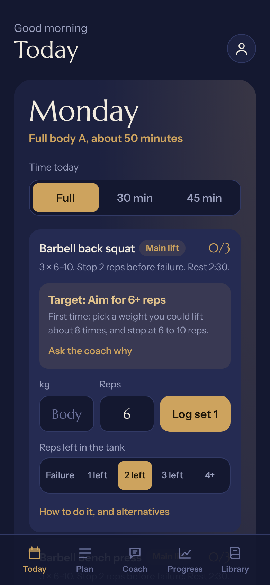
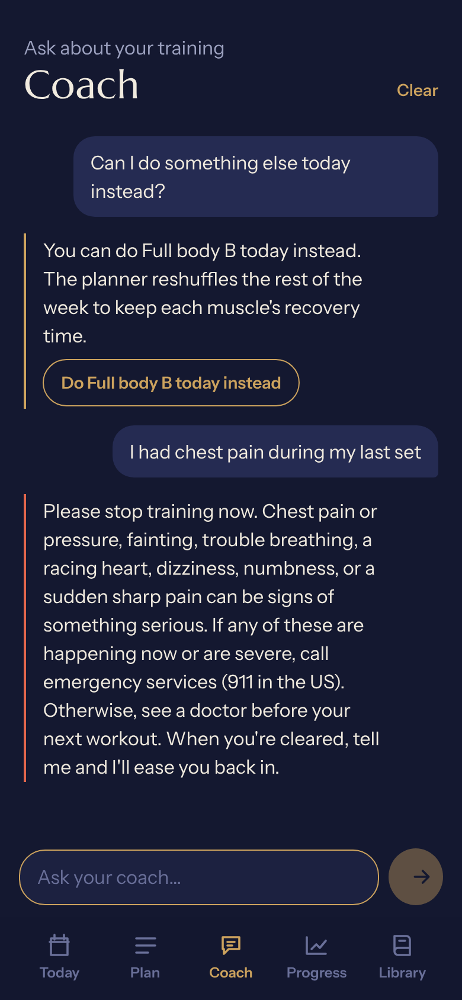
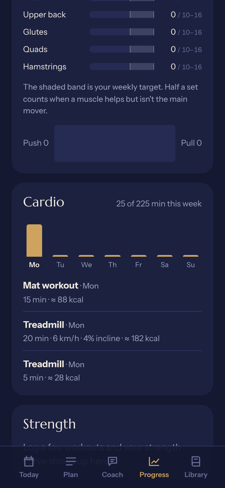
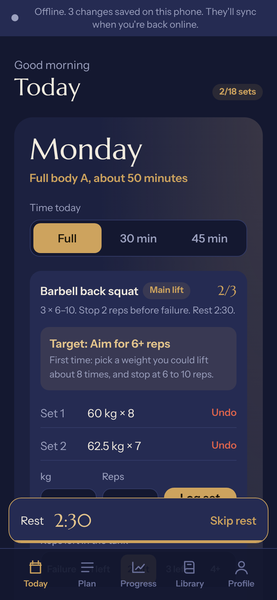
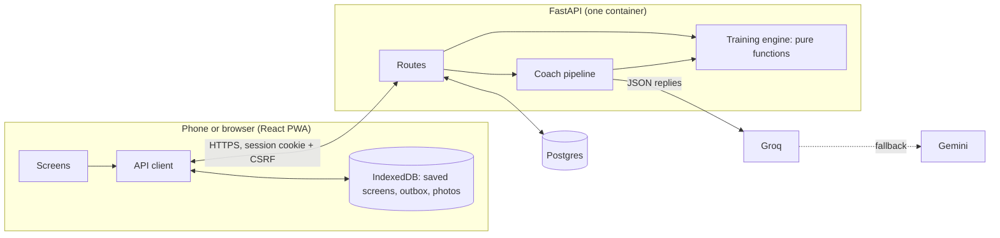

# Vyayam (ವ್ಯಾಯಾಮ)

**A personal gym coach that plans each training day around you.** An installable web
app (PWA) that works offline. A deterministic, tested engine makes every training
decision; an AI coach explains and adapts, and the engine checks everything it proposes.

**Live:** [vyayam-08h5.onrender.com](https://vyayam-08h5.onrender.com) (free hosting:
the first visit after a quiet spell takes up to a minute to wake up)

**Try it without signing up:** open the link and tap **Try the demo**. It's a sample
account with four weeks of training, check-ins, weigh-ins and cardio, with today's
session left open to log. It's shared and reset from time to time, so please don't
enter anything personal.

[](https://github.com/anupvna/vyayam/actions/workflows/ci.yml)

<p>
  
  
  
  
</p>

> A training aid, not medical advice.

## What it does

- **Plans your week** for any split (full body, upper/lower, push/pull/legs and more, or
  your own), around your training days, session length, gym equipment and injuries.
  Skip or swap a day and the rest of the week rebalances.
- **Coaches each set:** a target weight and reps from your last sessions (double
  progression), estimated 1-rep max and records, a rest timer, and a daily check-in
  that lightens the session when you're sore or under-slept and stops it on red-flag
  symptoms.
- **Tracks progress:** weight trend with a goal-date range, body fat and measurements,
  sets per muscle against weekly targets, strength curves, a recovery body map,
  consistency, and progress photos that never leave the phone.
- **Cardio and floor work:** log any activity (treadmill speed and incline, machine
  levels, the mat moves you did, calories or an estimate), a weekly cardio target from
  your goal, warm-up, finisher and cool-down stretches, and "train at home on a mat
  today", which swaps every exercise for a floor version.
- **Works offline:** opens with no signal, logs sets, check-ins and cardio on the phone,
  and syncs when the connection is back.
- **AI coach:** answers from your own data ("why this weight today?", "I only have 30
  minutes", "I'm at home today") and proposes changes as buttons you tap.

## Architecture



**The coach pipeline.** Every message goes through, in order: a safety screen (medical
red flags, crisis, disordered eating, drugs and diagnosis questions get fixed answers
and never reach an AI) → the user's data as context (no email or name) → Groq, then
Gemini → checks on the reply (valid JSON schema, safety, **no invented numbers**: any
weight, percentage or calorie figure must come from the user's data) → a rule-based
coach if every provider fails. Proposed actions are checked by the engine when shown
and again when tapped.

## Design decisions

- **The engine decides; the AI explains.** Planning, progression, recovery and body
  maths are pure, unit-tested functions, so behaviour is predictable and auditable. The
  AI can only propose a fixed set of actions, which the engine validates.
- **Offline-first without conflicts.** Sets and activities get their id on the phone,
  so the server can treat a resend as a no-op. Changes wait in an ordered outbox, merge
  locally (undoing an unsent set cancels both), and replay when the connection returns.
- **Privacy by design.** Progress photos stay in the browser's storage and are never
  uploaded. The AI never receives identity. Saved data and the outbox are per user and
  wiped on logout.
- **Security basics done properly.** argon2id passwords, server-side sessions storing
  only a token hash, HttpOnly + Secure + SameSite cookies, a CSRF header on every
  change, login rate limiting, and secrets only in the environment.
- **$0 to run.** Render's free web service, Neon's free Postgres, Groq's and Gemini's
  free tiers. Requests are kept small to fit free-tier token limits.

## Quality

| | |
|---|---|
| Backend tests | 478 (pytest), including property-based planner tests: every CI run checks 3,600 generated weeks against the recovery, volume and time rules; a documented thorough run checked 25,000 with zero violations ([how](docs/PLANNER.md#how-its-tested)) |
| Frontend tests | 86 (vitest): offline outbox, merging and sync, units, calorie formulas, sign-up checks |
| Coach evaluation | 44 scenarios in 7 groups (explain, adapt, cardio, progress, nutrition, safety, robustness). Rule-based coach: 44/44 (runs in CI). Groq `gpt-oss-120b`: 42/44, with every safety and robustness case passed |
| Backend coverage | 95% of lines (pytest-cov, 478 tests); the engine's progression, readiness, cardio, splits and goals modules and the coach's safety screen are at 100% |
| Lighthouse (mobile, live site) | Performance 98, Accessibility 95, Best Practices 96, SEO 91. Largest paint 1.8 s, layout shift 0, blocking time 10 ms |
| API response time (live site) | Today's workout: p50 347 ms, p95 444 ms over 30 requests, all returning 200, from the US East Coast on Render's free tier. Timed from request sent to first byte; the health check takes 288 ms, so the app's own work adds about 60 ms |
| CI | GitHub Actions: lint (ruff), tests on Postgres 17, typecheck and frontend build |

Calorie estimates use the ACSM metabolic equations (walking and running, with incline)
and MET values from the Compendium of Physical Activities.

## Tech

| Layer | Choice |
|---|---|
| Frontend | React 19, TypeScript, Vite, vite-plugin-pwa (Workbox), Apache ECharts |
| Backend | Python 3.12, FastAPI, Pydantic v2, asyncpg with plain SQL and a small migration runner |
| Data | PostgreSQL (Neon in production), IndexedDB on the device |
| AI | Groq (`openai/gpt-oss-120b`, strict JSON schema), Gemini as backup, plain HTTPS via httpx |
| Hosting | Docker on Render (one container serves the app and the API) |

## Run locally

Requirements: Docker, Python 3.12, Node 22+.

```bash
cp .env.example .env                 # local settings (never committed)
docker compose up -d                 # Postgres on localhost:5433
python3.12 -m venv .venv && source .venv/bin/activate
pip install -e "backend[dev]"

cd backend
python -m app.migrate                # create tables
uvicorn app.main:app --reload        # API on http://localhost:8000
```

Frontend, in a second terminal:

```bash
cd frontend
npm install
npm run dev                          # app on http://localhost:5173 (proxies /api to :8000)
```

Tests: `pytest` in `backend/`, `npm test` in `frontend/`. Coach evaluation:
`python -m app.coach.eval --provider engine` (or `groq` / `gemini` with keys in `.env`).

## Docs

- [Planner](docs/PLANNER.md) · [Training](docs/TRAINING.md) · [Progress](docs/PROGRESS.md) · [Offline](docs/OFFLINE.md) · [Coach](docs/COACH.md) · [Cardio](docs/CARDIO.md)
- [Deploying](docs/DEPLOY.md) · [Licenses](docs/LICENSES.md) · [Roadmap](docs/ROADMAP.md)

Exercise facts come from the public-domain free-exercise-db; all illustrations, coaching
cues, stretches and the muscle map are original. See [Licenses](docs/LICENSES.md).
